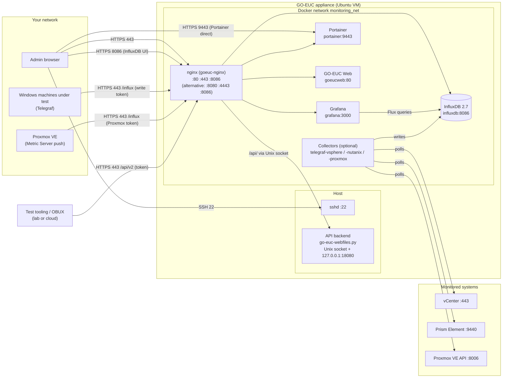
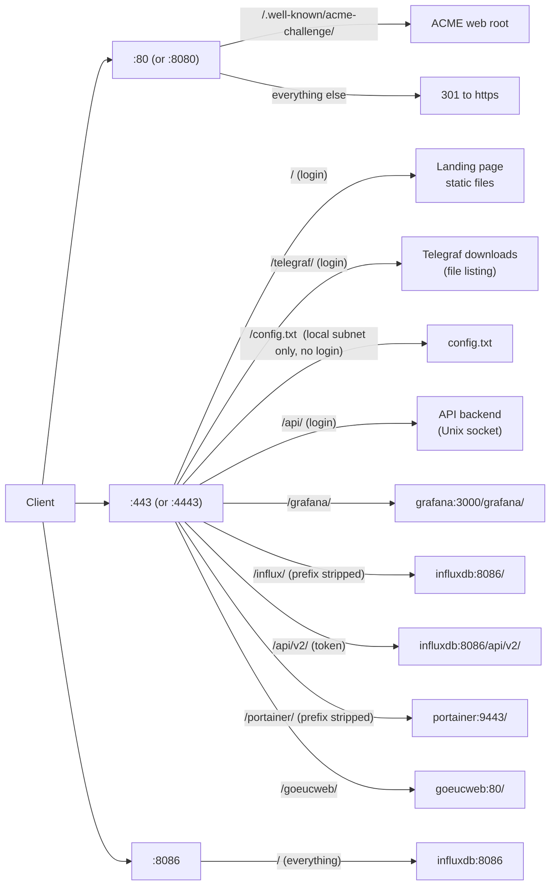
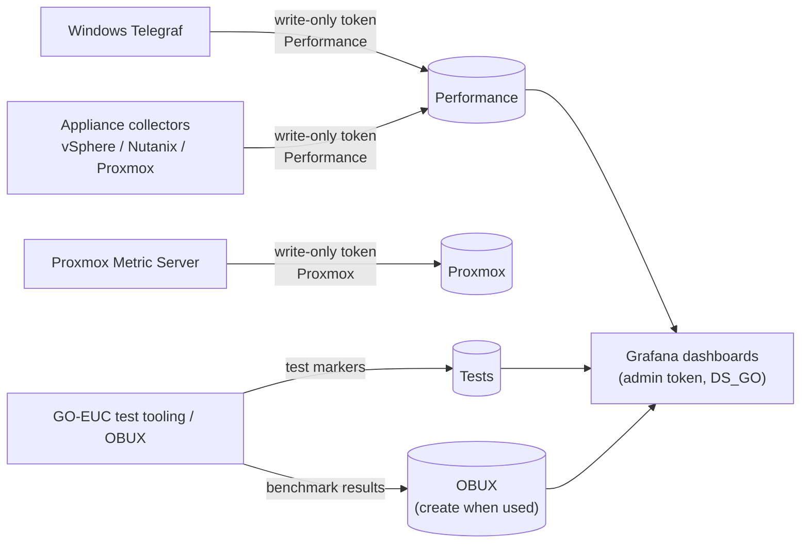
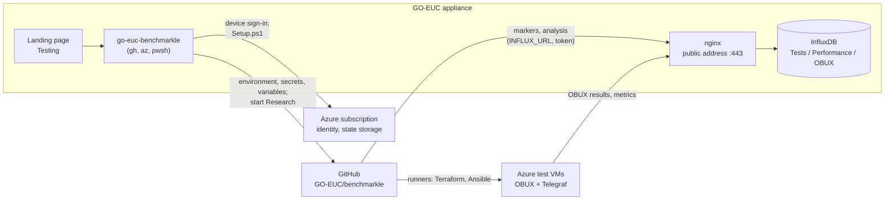
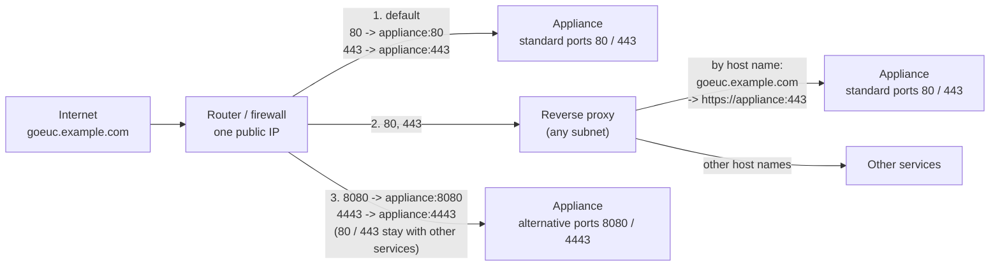

# Appliance architecture

How the GO-EUC appliance is put together: what listens where, how requests are routed, what talks to what, and what to forward on a router when the appliance must be reachable from outside your network. Ports and paths match `scripts/step1_install_base.sh` (Docker Compose) and the nginx configuration written by `appliance/firstboot/go-euc-firstboot.sh`.

The web server's ports are a choice: **standard 80/443** (the default) or **alternative 8080/4443** (*Maintenance → Web ports* on the landing page, or `sudo go-euc-set-ports alternative`). Wherever this page says 80 or 443, read 8080 or 4443 on an appliance using the alternative ports. InfluxDB's 8086, Portainer's 9443 and SSH 22 never change.

## Overview

- **One way in:** nginx is the only container published on ports 80, 443 and 8086 (8080, 4443 and 8086 with the alternative ports). It terminates TLS (self-signed or Let's Encrypt) and routes requests to the containers on the internal Docker network.
- **Not reachable from outside:** InfluxDB and GO-EUC Web aren't published on the host. Grafana listens on `127.0.0.1:3000` only. The landing page's API backend runs on the host, and nginx reaches it through a Unix socket (`/opt/influx-grafana/run/api.sock`), so it never listens on the network.
- **Portainer** is the exception: it's also published directly on 9443, its own HTTPS port.

## Ports

| Port | Listens | Service | Who connects |
|---|---|---|---|
| 22 | host | SSH (`goeucadmin`, break-glass; password login after the setup wizard) | admins |
| 80 (alternative: 8080) | nginx | Redirects to HTTPS; Let's Encrypt HTTP validation (`/.well-known/acme-challenge/`) | browsers; Let's Encrypt (from the internet) |
| 443 (alternative: 4443) | nginx | Landing page, Grafana, Portainer, GO-EUC Web, InfluxDB API (`/influx` and `/api/v2`), API backend | browsers; Telegraf clients; Proxmox Metric Server; test tooling |
| 8086 | nginx | InfluxDB UI and API over TLS (whole host:port is InfluxDB) | admins; tools that want InfluxDB at the root of a host:port |
| 9443 | Portainer | Portainer direct (HTTPS) | admins (optional) |
| 3000 | `127.0.0.1` only | Grafana (local health checks) | the appliance itself |
| 18080 | `127.0.0.1` only | API backend (local use, e.g. `curl http://127.0.0.1:18080/config.txt`) | the appliance itself |

Closed on purpose: InfluxDB's own 8086 (nginx serves 8086 instead), Portainer's edge port 8000, and Grafana from the network.

The web ports are kept in `/etc/go-euc/config.env` (`APPLIANCE_HTTP_PORT`, `APPLIANCE_HTTPS_PORT`). `go-euc-set-ports` updates the Compose port mapping, the HTTP → HTTPS redirect, the Telegraf configs, `config.txt` and the install summary, then recreates the nginx container. The landing page calls it through `POST /api/ports`. Inside the container nginx always listens on 80 and 443; only the host side of the mapping changes.

## Request routing (nginx)

| Path on 443 | Goes to | Access control |
|---|---|---|
| `/` | Landing page (static files) | appliance login (`goeucadmin`, HTTP basic auth) |
| `/telegraf/` | Telegraf package and configs, with a file listing | appliance login |
| `/config.txt` | All appliance credentials | **no login, local subnet only** (allow-list from `go-euc-local-access.sh`); everyone else gets 403 |
| `/api/` | API backend: collectors, full update, Let's Encrypt, Telegraf refresh, web ports (`/api/v2/` is InfluxDB, see below) | appliance login |
| `/grafana/` | Grafana | Grafana's own login |
| `/influx/` | InfluxDB API (the `/influx` prefix is stripped; InfluxDB has no base-path setting) | InfluxDB token |
| `/api/v2/` | InfluxDB API at the root, for tools that take a host and port instead of a URL (OBUX, InfluxDB client libraries) | InfluxDB token |
| `/portainer/` | Portainer (prefix stripped; WebSocket enabled for consoles) | Portainer's own login |
| `/goeucweb/` | GO-EUC Web | none |

The InfluxDB **web UI** only works at the root of a host:port, so it's on `https://<appliance>:8086/`. The `/influx` path carries the API only.

## Data flow

| Token | Can do | Used by |
|---|---|---|
| InfluxDB admin token | everything | Grafana data source `DS_GO`, appliance tools (`config.txt`, `install-summary.txt`) |
| Telegraf write-only token | write `Performance` | Windows Telegraf configs (`/telegraf/`), infrastructure collectors |
| Proxmox write-only token | write `Proxmox` | Proxmox VE Metric Server |

## Testing with benchmarkle

The landing page's Testing section ([guide](testing-with-benchmarkle.md)) prepares and starts GO-EUC research; GitHub Actions and Azure do the work, and the results come back into the appliance's InfluxDB over its public address.

Secrets stay out of command lines: the GitHub token and the Azure sign-in are root-only on the appliance, environment secrets are set through `gh` on standard input, and the InfluxDB token in the environment can only read and write the three test buckets.

## Reaching the appliance from outside your network (port forwarding)

By default the appliance is meant for a lab network, and nothing needs to be forwarded. To reach it from the internet (Let's Encrypt, cloud test machines, Grafana from outside), there are three setups. [External access](external-access.md) walks through each one.

| Setup | Router | Appliance web ports | Certificate |
|---|---|---|---|
| 1. Direct (default) | 80 → appliance:80, 443 → appliance:443 | standard 80/443 | Let's Encrypt on the appliance |
| 2. Reverse proxy (one public IP shared with other services) | 80, 443 → proxy; proxy sends `goeuc.example.com` to `https://appliance:443` | standard 80/443 (or 4443) | on the proxy; the appliance keeps its self-signed certificate |
| 3. Alternative ports (80/443 already in use) | 8080 → appliance:8080, 4443 → appliance:4443; public address `https://goeuc.example.com:4443/` | alternative 8080/4443 | self-signed, or Let's Encrypt only if whatever owns port 80 passes `/.well-known/acme-challenge/` to appliance:8080 |

Never forward 22, 9443 or 8086; use a VPN for remote administration.

Things to know before forwarding:
- The landing page, `/telegraf/` and `/api/` stay behind the appliance login. Grafana and Portainer use their own logins, and the InfluxDB API (`/influx`, `/api/v2`) needs a token.
- `/config.txt` stays local-subnet only. Forwarded requests keep the client's real source address and get 403. Requests through a reverse proxy come from the proxy's address and get 403 unless the proxy is on the appliance's subnet. Traffic over IPv6 is relayed by Docker's proxy and is always refused for `config.txt`.
- Use Let's Encrypt (Certificates on the landing page) once port 80 and DNS are in place. External clients then verify TLS normally. The certificate's deploy hook switches every address the appliance hands out to `https://<domain>/` (`https://<domain>:4443/` on the alternative ports): the Telegraf configs (`go-euc-publish-telegraf-config.sh`), the Proxmox Metric Server settings, and Grafana's own URL (`go-euc-grafana-url.sh`) for share and alert links.
- Behind a reverse proxy, or with a DNS name but no certificate on the appliance, set a **public host name** (*Maintenance → Public host name*, `go-euc-set-hostname`): it takes priority over the Let's Encrypt domain for every address handed out (`go-euc-public-url.sh`).

## Outbound connections from the appliance

| To | Port | When |
|---|---|---|
| Ubuntu mirrors (`archive.ubuntu.com`, `security.ubuntu.com`) | 80 | first boot, full update |
| Docker (`download.docker.com`, `registry-1.docker.io`, `auth.docker.io`, `production.cloudflare.docker.com`) | 443 | first boot, updates, collectors |
| `api.github.com`, `github.com`, `dl.influxdata.com` | 443 | Telegraf for Windows download |
| Azure Blob (`goeucartifacts4hiu9i.blob.core.windows.net`) | 443 | dashboard bundle updates |
| `acme-v02.api.letsencrypt.org` | 443 | Let's Encrypt |
| `packages.microsoft.com`, `cli.github.com` | 443 | PowerShell, Azure CLI and GitHub CLI packages (first boot, full update) |
| `api.github.com`, `github.com` | 443 | Testing: your benchmarkle environment, research runs |
| `login.microsoftonline.com`, `login.microsoft.com`, `management.azure.com`, `graph.microsoft.com` | 443 | Testing: Azure sign-in and `Setup.ps1` |
| `api.anthropic.com` | 443 | Testing: checking the Anthropic API key |
| vCenter / Prism Element / Proxmox VE | 443 / 9440 / 8006 | infrastructure collectors |
| Old appliance | 8086 (+ its web port for `config.txt` and Grafana) | `go-euc-migrate` |

## On disk

| Path | Contents |
|---|---|
| `/opt/influx-grafana/stack/` | `docker-compose.yml`, InfluxDB data, Grafana data, provisioning, dashboards |
| `/opt/influx-grafana/nginx/` | `conf.d/default.conf`, `certs/`, `auth/` (htpasswd, local-subnet allow-list), ACME web root |
| `/opt/influx-grafana/public/` | Landing page, `telegraf/` downloads, `config.txt` |
| `/opt/influx-grafana/run/api.sock` | API backend socket (shared with nginx) |
| `/opt/influx-grafana/collectors/` | Rendered collector configs (no secrets) |
| `/opt/influx-grafana/credentials.env`, `install-summary.txt` | Credentials (root-only) |
| `/etc/go-euc/` | `config.env` (wizard answers, web ports, public host name), collector settings, break-glass account, dashboard URL |
