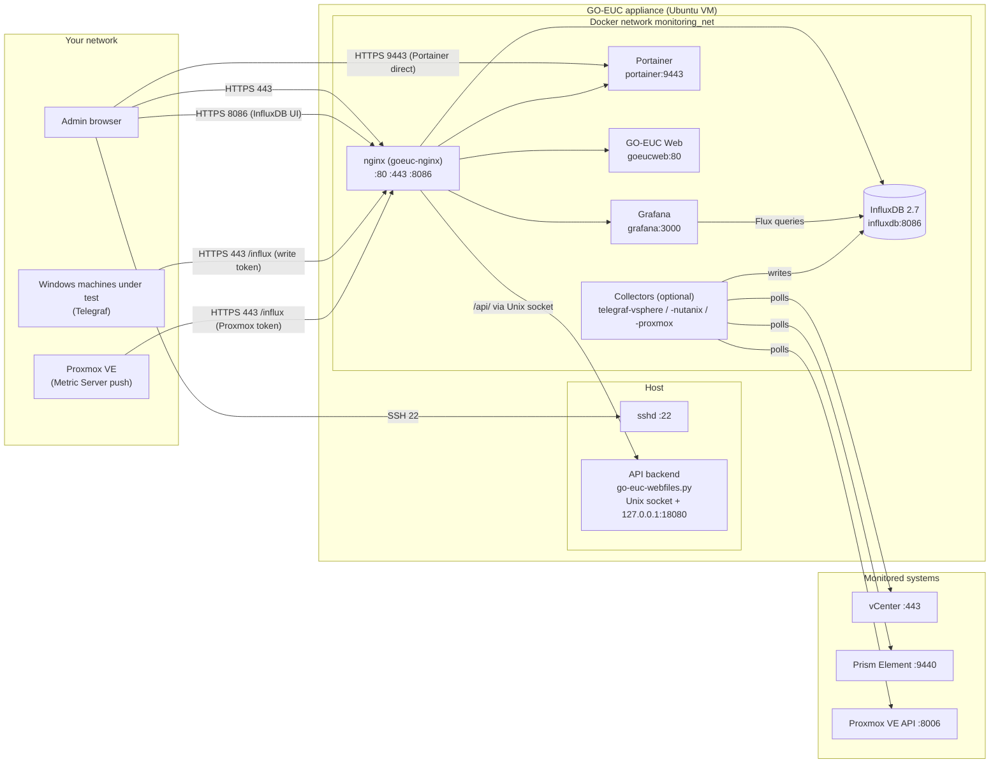
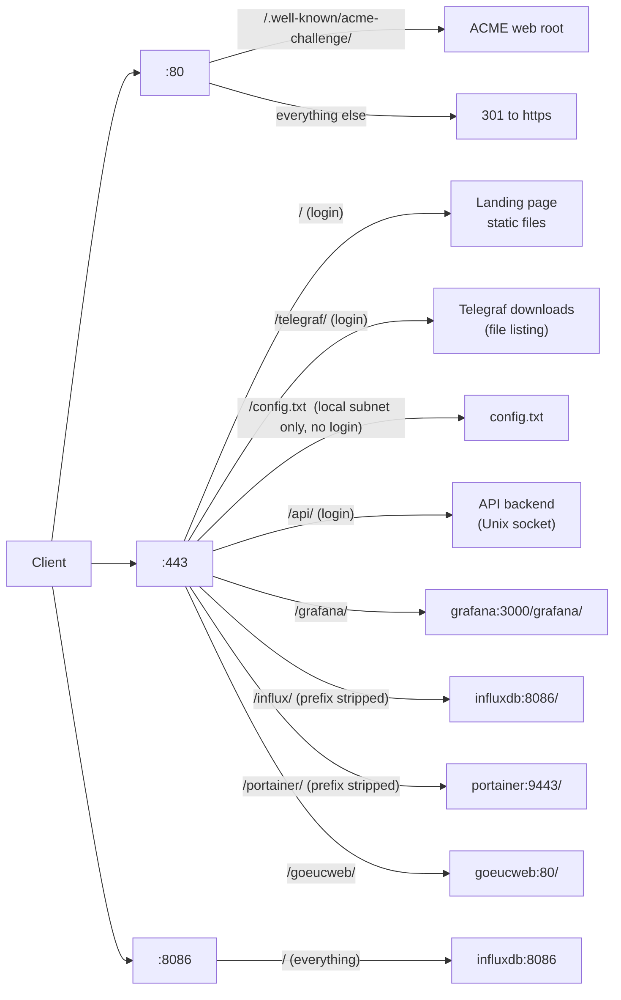
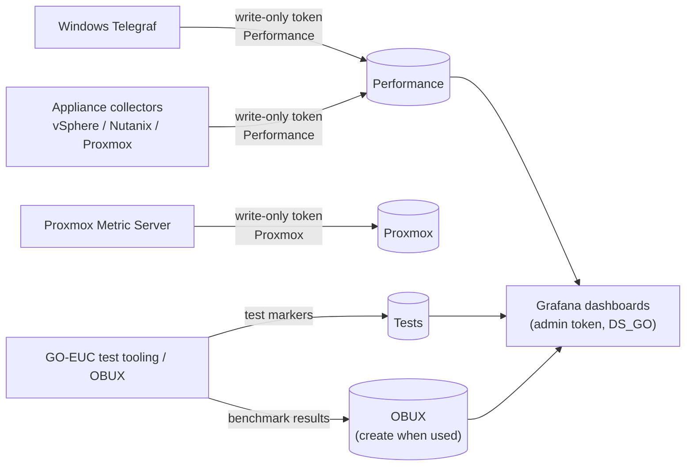
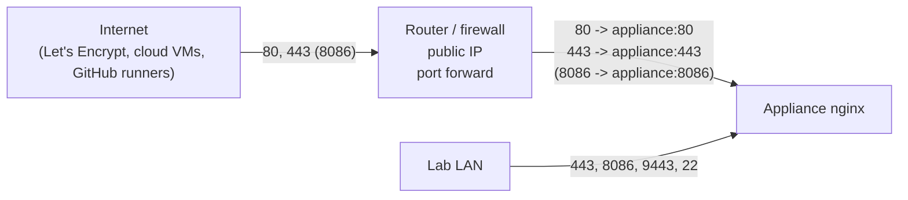

# Appliance architecture

How the GO-EUC appliance is put together: what listens where, how requests are routed, what talks to what, and what to forward on a router when the appliance must be reachable from outside your network. Ports and paths match `scripts/step1_install_base.sh` (Docker Compose) and the nginx configuration written by `appliance/firstboot/go-euc-firstboot.sh`.

## Overview

- **One way in:** nginx is the only container published on ports 80, 443 and 8086. It terminates TLS (self-signed or Let's Encrypt) and routes requests to the containers on the internal Docker network.
- **Not reachable from outside:** InfluxDB and GO-EUC Web aren't published on the host. Grafana listens on `127.0.0.1:3000` only. The landing page's API backend runs on the host, and nginx reaches it through a Unix socket (`/opt/influx-grafana/run/api.sock`), so it never listens on the network.
- **Portainer** is the exception: it's also published directly on 9443, its own HTTPS port.

## Ports

| Port | Listens | Service | Who connects |
|---|---|---|---|
| 22 | host | SSH (`goeucadmin`, break-glass; password login after the setup wizard) | admins |
| 80 | nginx | Redirects to HTTPS; Let's Encrypt HTTP validation (`/.well-known/acme-challenge/`) | browsers; Let's Encrypt (from the internet) |
| 443 | nginx | Landing page, Grafana, Portainer, GO-EUC Web, InfluxDB API (`/influx`), API backend | browsers; Telegraf clients; Proxmox Metric Server |
| 8086 | nginx | InfluxDB UI and API over TLS (whole host:port is InfluxDB) | admins; tools that want InfluxDB at the root of a host:port |
| 9443 | Portainer | Portainer direct (HTTPS) | admins (optional) |
| 3000 | `127.0.0.1` only | Grafana (local health checks) | the appliance itself |
| 18080 | `127.0.0.1` only | API backend (local use, e.g. `curl http://127.0.0.1:18080/config.txt`) | the appliance itself |

Closed on purpose: InfluxDB's own 8086 (nginx serves 8086 instead), Portainer's edge port 8000, and Grafana from the network.

## Request routing (nginx)

| Path on 443 | Goes to | Access control |
|---|---|---|
| `/` | Landing page (static files) | appliance login (`goeucadmin`, HTTP basic auth) |
| `/telegraf/` | Telegraf package and configs, with a file listing | appliance login |
| `/config.txt` | All appliance credentials | **no login, local subnet only** (allow-list from `go-euc-local-access.sh`); everyone else gets 403 |
| `/api/` | API backend: collectors, full update, Let's Encrypt, Telegraf refresh | appliance login |
| `/grafana/` | Grafana | Grafana's own login |
| `/influx/` | InfluxDB API (the `/influx` prefix is stripped; InfluxDB has no base-path setting) | InfluxDB token |
| `/portainer/` | Portainer (prefix stripped; WebSocket enabled for consoles) | Portainer's own login |
| `/goeucweb/` | GO-EUC Web | none |

The InfluxDB **web UI** only works at the root of a host:port, so it's on `https://<appliance>:8086/`. The `/influx` path carries the API only.

## Data flow

| Token | Can do | Used by |
|---|---|---|
| InfluxDB admin token | everything | Grafana data source `DS_GO`, appliance tools (`config.txt`, `install-summary.txt`) |
| Telegraf write-only token | write `Performance` | Windows Telegraf configs (`/telegraf/`), infrastructure collectors |
| Proxmox write-only token | write `Proxmox` | Proxmox VE Metric Server |

## Reaching the appliance from outside your network (port forwarding)

By default the appliance is meant for a lab network, and nothing needs to be forwarded. Forward ports on your router or firewall only for things that must reach it from the **internet**:

| Need | Forward to the appliance | Also needed |
|---|---|---|
| Let's Encrypt certificate | TCP **80** | a public DNS name (A record) pointing at your public IP |
| Telegraf / test tooling running outside your network (e.g. cloud VMs) | TCP **443** (API at `/influx`), or TCP **8086** | Let's Encrypt (so clients can verify TLS), and a token for that tooling |
| Remote administration | prefer a VPN; avoid forwarding 22, 9443 or 8086 | |

Things to know before forwarding 443:
- The landing page, `/telegraf/` and `/api/` stay behind the appliance login. `/config.txt` stays local-subnet only, so forwarded requests get 403. Grafana, InfluxDB and Portainer use their own logins and tokens.
- Use Let's Encrypt (Certificates on the landing page) once 80 and DNS are in place. External clients then verify TLS normally, and `go-euc-publish-telegraf-config.sh` switches the Telegraf configs to the DNS name.
- Forwarded traffic arrives with the client's real source address, so the `config.txt` subnet rule keeps working. Traffic over IPv6 is relayed by Docker's proxy and is always refused for `config.txt`.

## Outbound connections from the appliance

| To | Port | When |
|---|---|---|
| Ubuntu mirrors (`archive.ubuntu.com`, `security.ubuntu.com`) | 80 | first boot, full update |
| Docker (`download.docker.com`, `registry-1.docker.io`, `auth.docker.io`, `production.cloudflare.docker.com`) | 443 | first boot, updates, collectors |
| `api.github.com`, `github.com`, `dl.influxdata.com` | 443 | Telegraf for Windows download |
| Azure Blob (`goeucartifacts4hiu9i.blob.core.windows.net`) | 443 | dashboard bundle updates |
| `acme-v02.api.letsencrypt.org` | 443 | Let's Encrypt |
| vCenter / Prism Element / Proxmox VE | 443 / 9440 / 8006 | infrastructure collectors |
| Old appliance | 8086 (+ 443/80 for `config.txt`) | `go-euc-migrate` |

## On disk

| Path | Contents |
|---|---|
| `/opt/influx-grafana/stack/` | `docker-compose.yml`, InfluxDB data, Grafana data, provisioning, dashboards |
| `/opt/influx-grafana/nginx/` | `conf.d/default.conf`, `certs/`, `auth/` (htpasswd, local-subnet allow-list), ACME web root |
| `/opt/influx-grafana/public/` | Landing page, `telegraf/` downloads, `config.txt` |
| `/opt/influx-grafana/run/api.sock` | API backend socket (shared with nginx) |
| `/opt/influx-grafana/collectors/` | Rendered collector configs (no secrets) |
| `/opt/influx-grafana/credentials.env`, `install-summary.txt` | Credentials (root-only) |
| `/etc/go-euc/` | `config.env` (wizard answers), collector settings, break-glass account, dashboard URL |
