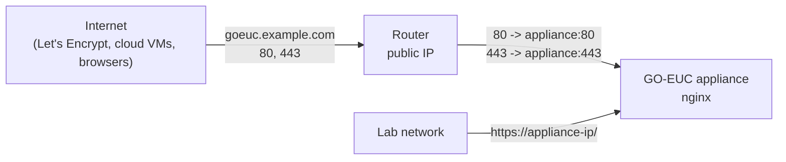
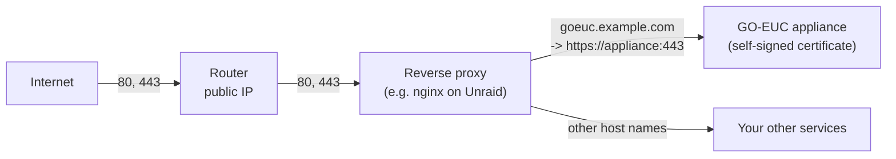
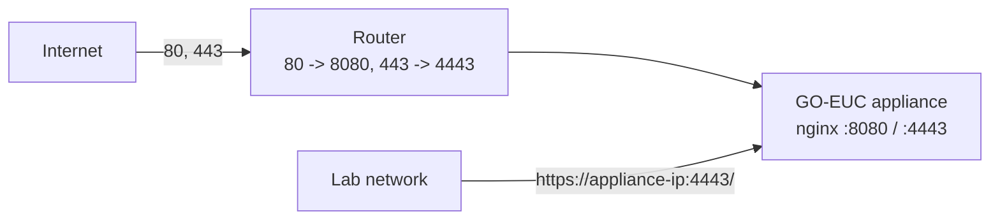

# Reaching the appliance from the internet

Most labs only use the appliance on their own network, and nothing on this page is needed for that. Make it reachable from the internet when something outside your network has to use it. For example:

- a trusted **Let's Encrypt** certificate (Let's Encrypt must reach the appliance on port 80)
- test machines or benchmark runs in the **cloud** (Azure, GitHub runners) that send their data to the appliance's InfluxDB
- looking at **Grafana** from outside the lab

You need:
- a public IP address
- a **DNS name** that points at it, for example `goeuc.example.com` (an A record at your DNS provider)
- a router or firewall where you can forward ports, or a reverse proxy you already run

Pick one of the three setups below. The first is the default.

## What's exposed, and what protects it

Forwarding 80 and 443 exposes the appliance's web server (nginx). Everything behind it has a login:

| Path | Protected by |
|---|---|
| `/` landing page, `/telegraf/`, `/api/` | appliance login (`goeucadmin` and the password you set in the setup wizard) |
| `/grafana/` | Grafana's own login |
| `/portainer/` | Portainer's own login |
| `/influx/` and `/api/v2/` (InfluxDB API) | an InfluxDB token |
| `/config.txt` | **only readable from the appliance's own subnet**; from the internet, or through a reverse proxy on another subnet, it returns 403 |
| `/goeucweb/` | none (GO-EUC Web) |

Not exposed unless you forward them as well: InfluxDB's web UI (8086), Portainer direct (9443) and SSH (22). Don't forward those; use a VPN for remote administration instead.

Use strong passwords: the setup wizard enforces one for `goeucadmin`, and the other services get random ones (see `config.txt` on the appliance's subnet). Portainer controls every container on the appliance, so if you don't need it from outside, block `/portainer/` on your reverse proxy (setup 2) or keep the appliance internal.

## Setup 1 (default): forward 80 and 443 to the appliance



1. **DNS:** create an A record, for example `goeuc.example.com`, pointing at your public IP.
2. **Router:** forward TCP **80** and TCP **443** to the appliance's IP address, on the same ports.
3. **Check:** from outside your network (for example a phone on mobile data), `http://goeuc.example.com/` should redirect to `https://goeuc.example.com/` and show a certificate warning. The warning is expected until the next step.
4. **Certificate:** on the landing page, go to **Certificates → Let's Encrypt setup** and enter the domain and your email. The appliance requests the certificate and installs it, and renewals are automatic. Everything the appliance hands out switches to the domain:
   - the Telegraf configs under `/telegraf/` use `https://goeuc.example.com/influx` with full TLS verification;
   - the Proxmox Metric Server settings use the domain;
   - links Grafana generates (*Share → Copy link*, alert notifications) start with `https://goeuc.example.com/grafana/` instead of `http://localhost/grafana/`.
5. **Test:** `https://goeuc.example.com/grafana/` opens Grafana without a certificate warning.

On your own network, keep using `https://<appliance-ip>/` or the DNS name. If the router doesn't support "NAT loopback" (hairpinning), the DNS name may not work from inside the lab. That's harmless; use the IP inside.

## Setup 2: through a reverse proxy you already run (one public IP)

Use this when ports 80 and 443 on your router already go to another web server, for example nginx, Nginx Proxy Manager or SWAG on Unraid. One public IP is enough: the reverse proxy picks the destination by host name, so `goeuc.example.com` goes to the appliance and everything else keeps going where it goes today. The proxy and the appliance can be on different subnets, as long as the proxy can reach the appliance's IP on 443.



With a proxy in front, **the proxy holds the public certificate**: it answers Let's Encrypt for the host name, and the appliance keeps its self-signed certificate behind it. Most proxies (Nginx Proxy Manager, SWAG, the Unraid apps) send a host name to **one IP address and port**. That's all the appliance needs.

1. **DNS:** an A record for `goeuc.example.com` pointing at your public IP (same as setup 1).
2. **Proxy host** for `goeuc.example.com`. The field names below are Nginx Proxy Manager's; other proxies have the same settings.

   | Setting | Value |
   |---|---|
   | Scheme | **`https`** |
   | Forward hostname / IP | the appliance's IP, e.g. `192.168.1.50` |
   | Forward port | **`443`** (`4443` if the appliance uses the alternative web ports) |
   | Websockets Support | **on** (Portainer's container consoles) |
   | Block Common Exploits | on or off, either works |
   | SSL tab | *Request a new SSL Certificate* (Let's Encrypt), **Force SSL** on, HTTP/2 on |
   | Advanced tab (custom nginx configuration) | `client_max_body_size 32m;` and `proxy_read_timeout 3600s;` |

   Why these values:
   - **Scheme `https` to port 443.** The appliance only serves pages over HTTPS. Port 80 on the appliance only redirects, so a proxy pointed at `http://<appliance>:80` would loop.
   - **The upstream certificate isn't checked.** Nginx Proxy Manager doesn't verify it by default, so the appliance's self-signed certificate is accepted.
   - **Upload size.** Telegraf and Proxmox write batches to `/influx/` of up to 25 MB; the 1 MB default rejects them with 413.
   - **Read timeout.** *Run Full Appliance Update* on the landing page can take many minutes.
3. **Don't** use *Certificates → Let's Encrypt setup* on the appliance in this setup. The proxy answers Let's Encrypt's checks for the host name itself, so the appliance's request would fail.

Inside the lab, keep using `https://<appliance-ip>/`. The Telegraf downloads point at the appliance's IP, which suits machines in the lab. A machine outside the lab uses `url = "https://goeuc.example.com/influx"` in its Telegraf config, and can set `insecure_skip_verify = false` because the proxy's certificate is trusted.

Because the appliance has no certificate of its own here, links Grafana generates (*Share → Copy link*, alert notifications) still start with `http://localhost/grafana/`. Replace that part with `https://goeuc.example.com/grafana/` when you share one.

Through the proxy, the InfluxDB web UI isn't available, because it lives on port 8086. The landing page's InfluxDB tile only works from inside the lab. The InfluxDB API works through the proxy at `/influx` and `/api/v2`.

If your proxy is plain nginx, this is the same setup (on the proxy, not the appliance):

```nginx
server {
  listen 80;
  server_name goeuc.example.com;
  location /.well-known/acme-challenge/ { root /var/www/certbot; }   # the proxy's own Let's Encrypt
  location / { return 301 https://$host$request_uri; }
}
server {
  listen 443 ssl;
  server_name goeuc.example.com;
  ssl_certificate     /etc/letsencrypt/live/goeuc.example.com/fullchain.pem;  # the proxy's own certificate
  ssl_certificate_key /etc/letsencrypt/live/goeuc.example.com/privkey.pem;
  client_max_body_size 32m;
  proxy_read_timeout 3600s;
  location / {
    proxy_pass https://192.168.1.50:443;
    proxy_ssl_verify off;                  # appliance's self-signed certificate
    proxy_set_header Host $host;
    proxy_set_header X-Forwarded-For $proxy_add_x_forwarded_for;
    proxy_set_header X-Forwarded-Proto https;
    proxy_http_version 1.1;                # WebSockets (Portainer consoles)
    proxy_set_header Upgrade $http_upgrade;
    proxy_set_header Connection "upgrade";
  }
}
```

Requests through the proxy come from the proxy's address, so `/config.txt` is refused unless the proxy is on the appliance's own subnet. That's intended: read `config.txt` from inside the lab.

## Setup 3: the appliance on the alternative ports (8080 / 4443)

The appliance's web server can listen on **8080 (HTTP) and 4443 (HTTPS)** instead of 80/443. Use this when something else on the same address must keep 80/443, or your router can forward an external port to a different internal port but you prefer to keep 80/443 free on the appliance.

**Change the ports:**
- **Landing page:** *Maintenance → Web ports*, choose *Alternative*, *Apply ports*. The page moves to `https://<appliance-ip>:4443/`. Your browser may ask for the appliance login and the certificate warning again, because it's a new address.
- **SSH or console:** `sudo go-euc-set-ports alternative`, and `sudo go-euc-set-ports standard` to go back.
- **Before the first boot** (cloud-init or `config.env`): `APPLIANCE_HTTP_PORT=8080` and `APPLIANCE_HTTPS_PORT=4443`.

Everything that contains the appliance's address follows automatically: the Telegraf configs, `config.txt`, the install summary and the Proxmox Metric Server settings. Windows machines that already run Telegraf need the new config from `/telegraf/`, and Proxmox Metric Server needs the new port. InfluxDB's 8086, Portainer's 9443 and SSH 22 don't change.

**Router, so the internet still uses the normal ports:**

| External (router) | Internal (appliance) |
|---|---|
| TCP 80 | appliance:**8080** |
| TCP 443 | appliance:**4443** |

Let's Encrypt still works: it validates on external port 80, which the router sends to 8080. On your own network the appliance is at `https://<appliance-ip>:4443/`. Once the certificate is active, the appliance's links use the domain on the normal port, `https://goeuc.example.com/`, because that's the address the router publishes.



## Using the appliance's InfluxDB from outside

Tools outside your network write to the appliance's InfluxDB through the web server:

| Tool expects | Use |
|---|---|
| a URL with a path (Telegraf, most clients) | `https://goeuc.example.com/influx` |
| InfluxDB at the root of a host:port (for example OBUX `/influxdburl` + `/influxdbport`, InfluxDB client libraries) | `https://goeuc.example.com` on port 443: the appliance answers `/api/v2/...` directly |

Give each tool a token that can only write to the buckets it needs. Create one in the InfluxDB UI (`https://<appliance-ip>:8086/` from inside the lab → *Load Data → API Tokens*). Don't hand out the admin token.

To check everything at once from a client, run `testing/checks/public_checks.sh <public-name> <appliance-ip>` from the repo (see [testing/README.md](../testing/README.md)).

## Troubleshooting

| Symptom | Check |
|---|---|
| Let's Encrypt on the appliance fails with "connection refused", "timeout" or "unauthorized" | The DNS name must resolve to your public IP (`nslookup goeuc.example.com 1.1.1.1`). External port 80 must reach the appliance's HTTP port: test `http://goeuc.example.com/.well-known/acme-challenge/test` from outside, which should return the appliance's 404, not your router's page. Behind a reverse proxy (setup 2), let the proxy get the certificate instead. |
| Through the proxy: "502 Bad Gateway" | The proxy host must use scheme **https** and port **443** (4443 with the alternative ports), and the proxy must reach the appliance's IP. Test from the proxy machine with `curl -k https://<appliance-ip>/grafana/`. |
| Through the proxy: "too many redirects" | The proxy host points at `http://<appliance>:80`. Use `https` and port 443. |
| Works inside the lab, not from outside | The router forward or the firewall rule is missing; or the ISP blocks inbound 80/443 (try setup 3 with other external ports to confirm). |
| Works from outside, not from inside with the DNS name | The router has no NAT loopback. Use the IP inside the lab, or add an internal DNS record pointing the name at the appliance (or the proxy). |
| Telegraf from outside: `x509: certificate is valid for ..., not ...` | Telegraf must use the DNS name, not the IP: download the config again from `/telegraf/` once Let's Encrypt is active. |
| Writes fail with `413 Request Entity Too Large` | Raise the reverse proxy's upload limit (`client_max_body_size 32m;`). |
| Portainer console doesn't open through the proxy | Turn on WebSocket support on the proxy. |
| `/config.txt` returns 403 | Expected from outside and through a proxy on another subnet. Read it from a machine on the appliance's subnet. |
| The landing page didn't come back after *Web ports* | Go to `https://<appliance-ip>:4443/` (alternative) or `https://<appliance-ip>/` (standard). From the console or SSH, `sudo go-euc-set-ports standard` puts everything back. |
